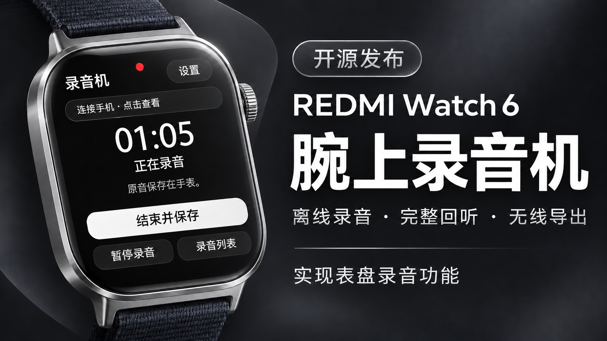

# Watch6 Recorder · Watch6 录音



为 REDMI Watch 6 提供离线录音、手表回听和手机无线导出。本项目不设云端账号，也不需要 API 密钥，录音保存在自己的设备上。

当前版本组合：**表盘 0.5.3 / Android App 0.5.1 / 手表连接组件 0.5.0**。

## 能做什么

- 在手表明确点击后开始录音，支持暂停、继续和结束保存。
- 在手表查看录音列表、完整回听，暂停、继续或停止播放。
- 通过已配对的小米运动健康链路发送到 Android 手机，支持断点续传。
- 手机校验并完整保存后，可播放、拖动进度、另存下载或通过系统菜单分享。
- 失败时保留原音和已接收进度；收齐后保存失败，可在手机点「完成保存」。

录音和本地回听可离线使用，不需要手机在附近。导出成功不会自动删除手表原音。本项目不包含语音转写、翻译或电脑输入功能。

## 支持范围

当前原生适配仅针对 **REDMI Watch 6 / P65 / 3.100.043**，且 AP/audio 镜像指纹必须吻合。相同版本名称不保证二进制兼容，未知固件会拒绝启动；请保留这些保护。

维护者已取得当前组合的单台设备使用正常反馈，并在 Android 实机验证完整保存修复。这不等于全部固件、长时间息屏、低空间和异常打断场景均已验收。

详细范围见 [兼容矩阵](docs/COMPATIBILITY.md) 和 [功能验收](docs/FEATURES.md)。

## 安装与使用

**[下载完整安装合集](https://github.com/qianliji/watch6-recorder/releases/download/v0.5.3/Watch6-Recorder-0.5.3-Install.zip)** · **[查看安装步骤](docs/INSTALL.md)** · [发布页全部文件](https://github.com/qianliji/watch6-recorder/releases/tag/v0.5.3)

| 位置 | 文件 | 用途 |
| --- | --- | --- |
| 手表表盘 | [Watch6-Recorder-0.5.3.bin](https://github.com/qianliji/watch6-recorder/releases/download/v0.5.3/Watch6-Recorder-0.5.3.bin) | 用「表盘自定义工具」安装；录音、列表、回听、发起导出 |
| 手表快应用 | [Watch6-Recorder-Identity-0.5.0.rpk](https://github.com/qianliji/watch6-recorder/releases/download/v0.5.3/Watch6-Recorder-Identity-0.5.0.rpk) | 用「表盘自定义工具」安装；提供通信身份，日常无需打开 |
| Android 手机 | [Watch6-Recorder-Phone-0.5.1.apk](https://github.com/qianliji/watch6-recorder/releases/download/v0.5.3/Watch6-Recorder-Phone-0.5.1.apk) | 在手机直接安装；接收、校验保存、手机回听和分享 |

1. 确认使用支持的 Watch 6 固件，手机为 Android 12 或以上，并已在小米运动健康中配对手表。
2. 解压安装合集。在手机直接安装 APK；用「表盘自定义工具」分别把 RPK 和 BIN 安装到手表，并启用录音表盘。安装工具由使用者自行准备。
3. 安装完成后，回到小米运动健康确认手表已连接。打开手机「Watch6 录音」→「连接」→「开启接收」，按提示完成附近设备、通知和运动健康通信授权。
4. 日常在录音表盘操作：开始 → 暂停/继续 → 结束保存 → 完整回听或发送到手机。连接组件只需安装保留，日常不用打开；不需要 USB、服务密钥或电脑配对码。
5. 手机显示完整保存后即可播放、另存下载或手动分享。100% 接收进度仍需完成最终校验与保存。

手机息屏接收需要系统允许运动健康和本应用在后台运行。系统强制停止、撤销权限后需重新启用。安装细节和修复记录见 [当前版本说明](docs/RELEASE_0.5.3.md)。

## 源码目录

| 目录 | 内容 |
| --- | --- |
| `src/` | 手表 Lua 页面、录音与回听流程、传输协调 |
| `native/`、`adapters/` | 原生采音、文件封存、播放、运动健康传输与精确适配 |
| `phone-app/src/`、`phone-app/assets/` | Android 接收端、持久化存储、播放器和界面 |
| `phone-app/watch-identity/` | 只提供通信身份的快应用源码 |
| `tests/`、`phone-app/tests/` | 合成数据、状态机、ARM 模拟与 Java/前端测试 |
| `tools/`、`docs/` | 构建辅助、独立 WAV 恢复、协议与开发文档 |

## 开发与构建

源码包包含项目实现与测试，不包含厂商固件、SDK、外部表盘打包器或签名私钥。构建者需自行提供合法取得的外部输入，配置示例在根目录及 `phone-app/`；个人配置使用被忽略的 `.local-build.json`。

发布页另提供预编译的 BIN、APK 和 RPK；APK 内含已集成的穿戴通信 SDK 运行代码，第三方部分的许可范围见 [NOTICE](NOTICE.md)。

```sh
python -m pip install -r requirements-build.txt
python tests/run_all.py --native
node phone-app/tests/frontend.test.cjs
python tools/package_source.py --check-only
```

完整测试还需 ARM GCC、JDK 等依赖；跨语言测试使用外置 JSON-java 测试依赖。构建入口是根目录 `python build.py` 与 `phone-app/build.py`。手机 APK 和身份 RPK 必须使用同一包名、同一证书；自建时使用自己的匹配签名，私钥不要提交。

具体配置、RPK 构建顺序和输出见 [BUILDING](BUILDING.md) 与 [手机构建说明](phone-app/README.md)。模拟测试不会使用真实麦克风、蓝牙或云端，也不能替代实机验收。

## 参与与许可

问题反馈请提供版本、步骤和去标识的错误信息，不需要上传真实会议录音。

- [贡献指南](CONTRIBUTING.md)
- [安全与隐私](SECURITY.md)
- [开源发布步骤](docs/PUBLISHING.md)
- [来源与第三方依赖](NOTICE.md)

项目自身有权授权的代码采用 [MIT](LICENSE)。固件、厂商 SDK、外部打包器等材料各自的许可继续适用，不因根目录 MIT 声明获得授权。本项目未获得小米官方背书。
